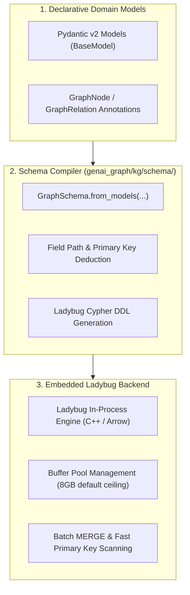

# Design 01: Knowledge Graph Foundation & Schema Compilation

## 1. Architectural Philosophy: Pydantic First, Embedded Execution

Enterprise Knowledge Graphs often fail in production due to two extremes:
1. **Unconstrained RDF/OWL ontologies**: Theoretically expressive, but computationally prohibitive and difficult for software engineers and LLMs to query cleanly.
2. **Proprietary schema registries**: Requiring separate database administration, complex schema migrations, and external network round-trips.

`genai-graph` adopts a **code-first, embedded architecture**:
- **Pydantic v2 as Single Source of Truth**: Data models define both domain Python objects and graph node/relationship schemas.
- **Embedded Ladybug Engine**: Embedded graph database (maintained fork of Kùzu) providing in-process Cypher queries without network overhead.
- **Deterministic Primary Key Hashing**: Guaranteed idempotency during ingestion without creating phantom or duplicate nodes.



---

## 2. Declarative Schema Definition

Defining a knowledge graph requires only standard Pydantic models:

```python
from pydantic import BaseModel, Field
from genai_graph.kg.schema.core import GraphNode, GraphRelation, GraphSchema

class Company(BaseModel):
    name: str = Field(..., description="Unique company name")
    sector: str
    country: str = "US"

class Investment(BaseModel):
    round_name: str
    amount_usd: float

# Register nodes and relations
schema = GraphSchema()
schema.add_node(GraphNode.from_model(Company, primary_key="name"))
schema.add_relation(GraphRelation(
    name="INVESTED_IN",
    from_node="Company",
    to_node="Company",
    properties_model=Investment,
))
```

The schema compiler automatically inspects types, deduces field paths, validates primary keys, and compiles Ladybug-compatible table schemas.

---

## 3. High-Throughput Batch MERGE & Buffer Pool Management

Ingesting hundreds of thousands of nodes and relationships into an embedded graph engine requires careful memory and plan optimization.

### Buffer Pool Management
Embedded Ladybug manages its own buffer pool in virtual memory.
`genai-graph` configures a safe default buffer pool ceiling (8GB) with safe fallbacks (`buffer_pool_size: 0` fallback instead of `None`) to prevent out-of-memory crashes on large imports.

### Batch Relationship MERGE Optimization
A known trap in Cypher engines during bulk `LOAD FROM <arrow_table>` is the inadvertent generation of a **Cartesian Cross-Product**:
```cypher
/* ❌ AVOID: Plans as CROSS_PRODUCT on disconnected node tables */
LOAD FROM tbl
MATCH (from:S {k: from_id}), (to:S {k: to_id})
MERGE (from)-[:R]->(to)
```

`genai-graph` optimizes relationship creation by using explicit property patterns that leverage primary key point-lookup scans:
```cypher
/* ✅ OPTIMIZED: Direct primary key point lookup */
MATCH (from:Company {name: row.from_name})
MATCH (to:Company {name: row.to_name})
MERGE (from)-[:INVESTED_IN {amount_usd: row.amount}]->(to)
```

---

## 4. Introspection & Schema Caching

To ensure sub-millisecond query planning across multi-tenant or concurrent operations, table and relationship metadata introspection is cached and strictly scoped to the active `LadybugBackend` instance:
- `backend.get_node_tables()` and `backend.get_rel_tables()` are lazily computed on first access.
- Caches are automatically invalidated when DDL statements (`CREATE TABLE`, `DROP TABLE`) are executed.

---

## 5. References & Cross-Links

- Implementation: `genai_graph/kg/backend.py`, `genai_graph/kg/schema/`
- User Guides: [docs/graph-definition-guide.md](../graph-definition-guide.md), [docs/schema-compilation.md](../schema-compilation.md)
- Next Design Document: [02_document_graph_decomposition.md](02_document_graph_decomposition.md) — Hierarchical Document Graph Decomposition
