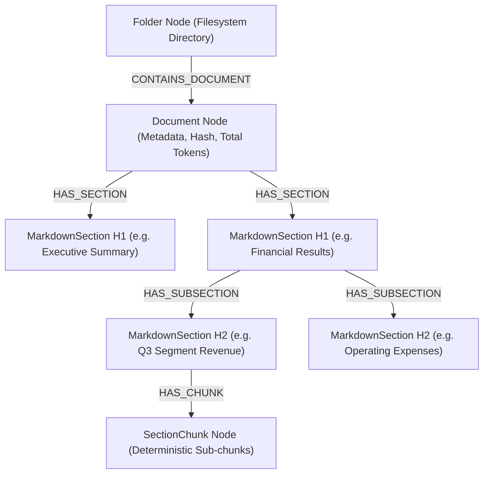
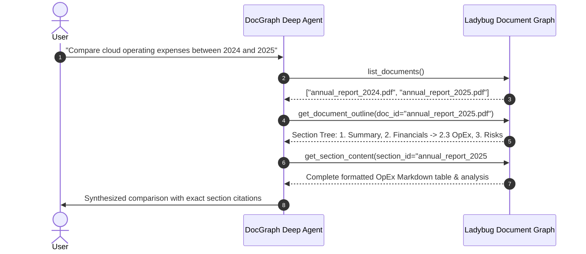

# Design 02: Hierarchical Document Graph & Agentic Navigation

## 1. Architectural Motivation: Structure-First vs. Vector Chunk Soup

Traditional RAG suffers from severe architectural defects when handling complex multi-page enterprise documents:
1. **Loss of Context**: Fixed-size chunking (e.g. 512 tokens with 50-token overlap) slices tables in half, severs headings from paragraphs, and discards document structure.
2. **Retrieval Blindness**: A query asking *"What was the EBITDA trend across Q1-Q4?"* requires seeing the table structure, not 5 disconnected text fragments scattered across the document.
3. **Hallucination by Fragment**: When an agent receives disjointed chunks without knowing where they fit in the document outline, it hallucinates connections.

`genai-graph` replaces naive chunking with the **Hierarchical Document Graph (DocGraph)**:
Documents are parsed into a deterministic graph tree of hierarchical sections matching the document's true structural outline.

---

## 2. The Document Graph Schema

The schema represents the document outline explicitly in Ladybug:

| Node Type | Properties | Meaning |
|---|---|---|
| `Folder` | `path`, `name` | Directory container on filesystem or cloud storage |
| `Document` | `doc_id`, `file_name`, `file_path`, `sha256`, `token_count` | The root document entity |
| `MarkdownSection` | `section_id`, `heading`, `level` (1-6), `content`, `token_count` | A structural section bounded by a Markdown heading |
| `SectionChunk` | `chunk_id`, `content`, `vector` | Leaf chunks for dense semantic retrieval when required |
| `Image` | `image_id`, `caption`, `base64_payload` | Stored figures and diagrams linked to containing sections |

Relationships include:
- `(Folder)-[:CONTAINS_DOCUMENT]->(Document)`
- `(Document)-[:HAS_SECTION]->(MarkdownSection)`
- `(MarkdownSection)-[:HAS_SUBSECTION]->(MarkdownSection)`
- `(MarkdownSection)-[:HAS_CHUNK]->(SectionChunk)`

---

## 3. Vectorless Agentic Navigation

Rather than performing a blind vector search and dumping chunks into prompt context, an autonomous agent navigates the Document Graph like a human analyst:

This navigation eliminates vector drift and enables 100% verifiable citations.

---

## 4. Hybrid Search with Dynamic Query Relaxation

When exact section titles are unknown, `genai-graph` provides hybrid full-text (BM25) and semantic vector search via `search_sections`:
- **Snowball Stemming**: Query and document tokens are stemmed using the Snowball algorithm, ensuring inflected forms (e.g. *investing*, *investments*, *investor*) match reliably.
- **Dynamic Query Relaxation**: If a multi-term boolean query yields zero results, the engine automatically relaxes restrictive constraints, falling back to soft disjunction with term re-weighting.
- **Extension-Agnostic Document Resolution**: Resolves references regardless of whether the user queries `report.pdf`, `report.md`, or simply `report`.

---

## 5. References & Cross-Links

- Implementation: `genai_graph/docgraph/`, `genai_graph/kg/nodes/document.py`
- User Guides: [docs/document-graph.md](../document-graph.md), [docs/document-decomposition-guide.md](../document-decomposition-guide.md), [docs/docgraph-agent.md](../docgraph-agent.md)
- Previous Design Document: [01_knowledge_graph_architecture.md](01_knowledge_graph_architecture.md) — Knowledge Graph Foundation & Schema Compilation
- Next Design Document: [03_access_control_and_security_trimming.md](03_access_control_and_security_trimming.md) — Enterprise Access Control & Security Trimming
