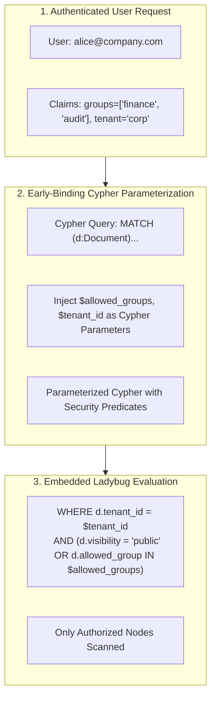

# Design 03: Enterprise Access Control & Security Trimming

## 1. Motivation: Preventing Data Leakage in Enterprise AI

In enterprise environments, documents carry strict access restrictions (confidential financial statements, executive compensation, M&A due diligence, HR records).
Naive agentic RAG architectures suffer from critical vulnerabilities:
1. **Late-Binding Filtering (Filter After Retrieval)**: Retrieving top-$k$ chunks from a global index and then discarding unauthorized items. An attacker can infer the existence of confidential documents or starve the context window.
2. **Context Leakage**: An agent asked to summarize departmental spending might inadvertently read an executive salary memo if documents lack graph-level authorization.
3. **Cypher Injection**: Constructing raw Cypher query strings with user-supplied role or group strings creates injection risks.

`genai-graph` implements **Early-Binding Security Trimming** (`genai_graph/kg/security/` and `genai_graph/docgraph/access_control.py`).



---

## 2. Early-Binding Security Trimming

In early-binding security trimming, unauthorized nodes are **never read or scanned** during query execution:

### Parameterized Security Predicates
Security clauses are injected directly into the Cypher query plan using parameterized lists, completely eliminating Cypher injection risks:

```cypher
MATCH (d:Document)-[:HAS_SECTION]->(s:MarkdownSection)
WHERE d.tenant_id = $tenant_id
  AND (
    d.visibility = 'public' 
    OR ANY(grp IN d.allowed_groups WHERE grp IN $user_groups)
  )
  AND to_lower(s.heading) CONTAINS $search_term
RETURN s.heading, s.content
```

If a user lacks the requisite group claim, the query returns empty results at the database engine level.

---

## 3. Fail-Closed Security Invariant

A fundamental security principle in `genai-graph` is **fail-closed**:
- If an authorization context is missing, corrupted, or cannot be resolved, the engine defaults to **zero visibility** (`visibility = 'public'` only, or an empty result set).
- It never "fails open" to reveal all documents.

---

## 4. Principal Propagation via Agent Harness

Identity claims flow transparently from the outer HTTP / CLI request through the `BaseHarness` into all graph tools:

```python
from genai_graph.docgraph.access_control import SecurityContext
from genai_graph.docgraph.tools import create_docgraph_query_tools

# Context established from authenticated JWT or CLI session
sec_ctx = SecurityContext(
    user_id="alice@atos.net",
    roles=["analyst"],
    groups=["nordics_sales", "emea_all"],
    tenant_id="atos_internal",
)

# Tools receive the security context and enforce it on every Cypher execution
tools = create_docgraph_query_tools(db_path="data/kg/enterprise.lbug", security_context=sec_ctx)
```

Any tool invocation initiated by the agent (e.g. `list_documents()`, `get_document_outline()`, `search_sections()`) automatically binds `sec_ctx` to the database query parameters.

---

## 5. References & Cross-Links

- Implementation: `genai_graph/docgraph/access_control.py`, `genai_graph/kg/backend.py`
- User Guide: [docs/access-control-security-trimming.md](../access-control-security-trimming.md)
- Previous Design Document: [02_document_graph_decomposition.md](02_document_graph_decomposition.md) — Hierarchical Document Graph & Agentic Navigation
- Next Design Document: [04_rule_selected_ingest_routing.md](04_rule_selected_ingest_routing.md) — Multi-Source Ingestion Routing & Route Tables
