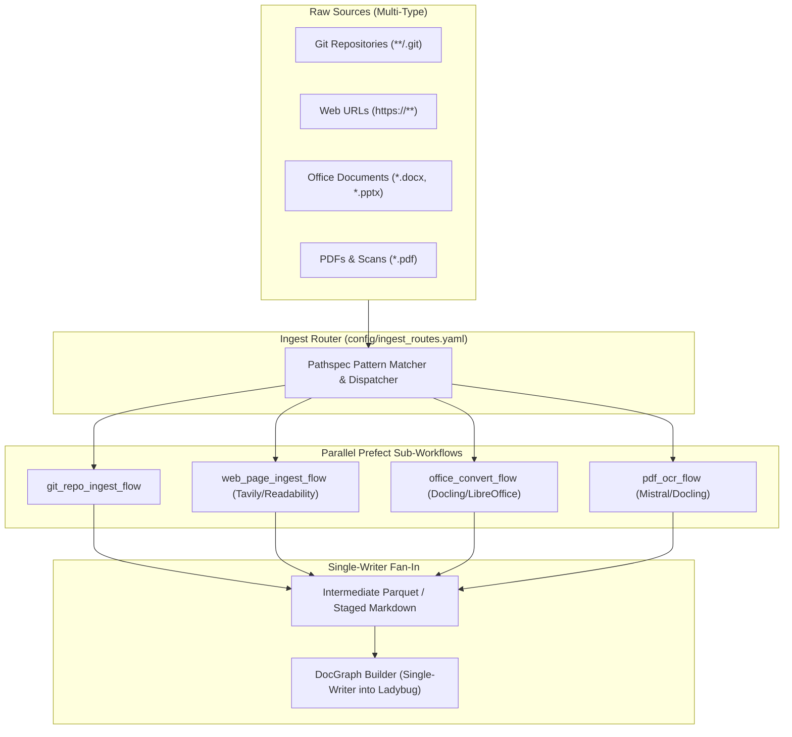

# Design 04: Multi-Source Ingestion Routing & Route Tables

## 1. Architectural Evolution: From Monolithic Ingestion to Route Dispatch

Historically, document graph ingestion mixed three separate concerns in a single Python flow:
1. **Source Discovery**: Finding files in input folders.
2. **Per-File Processing**: Choosing whether to OCR, convert Office via LibreOffice, scrape HTML, or clone Git repos.
3. **Graph Building**: Loading converted Markdown into the Ladybug database.

Adding any new source type (e.g. YouTube transcripts or web pages) required editing core Python orchestration code.

### The Orthogonal Solution
`genai-graph` connects gitignore-style pathspec routing directly to **declarative YAML workflows**:
- An **Ingest Router** evaluates source URIs against ordered route patterns in `config/ingest_routes.yaml`.
- Each matching pattern selects a targeted YAML workflow (implemented in `prefect-yaml`).
- All matched workflows run concurrently, outputting normalized Markdown into intermediate staging directories.
- A **Single-Writer Fan-In** step builds the Document Graph in a single atomic pass, eliminating concurrent database write locks.



---

## 2. Route Table Specification (`config/ingest_routes.yaml`)

Route rules are evaluated in top-to-bottom order. The first rule matching a source item determines its processing pipeline:

```yaml
routes:
  # 1. Git code repositories
  - pattern: "**/.git"
    workflow: ingest_git_repo
    params:
      extract_code: true
      include_commits: false

  # 2. Remote web documentation & articles
  - pattern: "https?://**"
    workflow: ingest_web_page
    params:
      fetcher: readability
      strip_nav: true

  # 3. Office presentations and spreadsheets
  - pattern: "**/*.{docx,pptx,xlsx}"
    workflow: ingest_office_via_pdf
    params:
      converter: docling

  # 4. Standard PDF documents
  - pattern: "**/*.pdf"
    workflow: ingest_pdf
    params:
      converter: docling

  # 5. Pre-rendered Markdown and text (fast copy)
  - pattern: "**/*.{md,txt}"
    workflow: direct_copy
```

---

## 3. Resolving the Single-Writer Constraint

Embedded graph databases like Ladybug require a single active writer process per database directory.
Earlier prototypes struggled when parallel ingestion workers attempted to write to Ladybug simultaneously, causing file lock collisions.

The routing architecture solves this completely:
1. **Upstream Parallelism**: All sub-workflows (PDF OCR, Web fetching, Git extraction) run completely in parallel, writing strictly isolated Markdown files to a staging scratchpad directory.
2. **Atomic Fan-In**: The `docgraph_build_step` runs only after all upstream conversion tasks have finished. It ingests the staged Markdown tree into Ladybug in a single, high-throughput pass.

---

## 4. Git Repository Ingestion Flow

For software engineering and architecture documentation, `genai-graph` includes a dedicated Git repository ingestion flow:
- Clones or traverses local `.git` trees.
- Extracts Markdown documentation (`README.md`, `docs/`, `*.md`).
- Preserves directory folder structures as `Folder` nodes in the Document Graph.
- Optionally indexes source code files with language-specific heading splitters.

---

## 5. References & Cross-Links

- Implementation: `genai_graph/orchestration/ingest_router.py`, `genai_tk/workflow/ingest/`
- Configuration: `config/ingest_routes.yaml`
- User Guide: [docs/workflows.md](../workflows.md)
- Previous Design Document: [03_access_control_and_security_trimming.md](03_access_control_and_security_trimming.md) — Enterprise Access Control & Security Trimming
- Next Design Document: [05_mcp_and_agent_navigation.md](05_mcp_and_agent_navigation.md) — Model Context Protocol (MCP 2.0) & Graph Tools
