# Design 05: Model Context Protocol (MCP 2.0) & Graph Navigation Tools

## 1. Motivation: Exposing Knowledge Graphs to Any Agent Ecosystem

Enterprise AI developers do not work exclusively in Python scripts. They use VS Code, Cursor, Windsurf, Claude Desktop, and headless autonomous agents.
To provide zero-friction graph exploration without requiring proprietary client libraries, `genai-graph` exposes its graph query capabilities via the **Model Context Protocol (MCP 2.0)** standard.

```mermaid
flowchart LR
    subgraph Clients["MCP Clients"]
        VSCODE["VS Code / Copilot"]
        CURSOR["Cursor / Windsurf"]
        CLAUDE["Claude Desktop"]
        AGENTS["Deep Agents (genai-tk)"]
    end

    subgraph Server["MCP 2.0 Server (genai_graph/mcp/)"]
        STDIO["Stdio Transport (Local CLI / Editor)"]
        SSE["SSE Transport (Remote HTTP Daemon)"]
        AUTH["Security Trimming & Tenant Context"]
    end

    subgraph Tools["Exposed MCP Tool Suite"]
        LIST["list_documents()"]
        OUTLINE["get_document_outline()"]
        FETCH["get_section_content()"]
        SEARCH["search_sections()"]
        CYPHER["query_cypher()"]
    end

    subgraph Backend["Ladybug Embedded Database"]
        DB["Ladybug Knowledge Graph (.lbug)"]
    end

    Clients <-->|MCP 2.0 Protocol| Server
    Server --> Tools
    Tools --> Backend
```



---

## 2. Core Navigation Tools Contract

The tool suite exposed over MCP and LangChain matches the human navigation pattern:

### 1. `list_documents`
Returns all documents available in the knowledge base, with optional filtering by folder path or file extension. Respects security trimming.

### 2. `get_document_outline`
Returns the structural heading tree (H1, H2, H3...) of a specific document, along with section token counts. Enables agents to plan which sections to read without consuming prompt budget.

### 3. `get_section_content`
Fetches the full Markdown content of a specific section by its deterministic `section_id` (e.g. `annual_report_2025.pdf#3.2`).

### 4. `search_sections`
Executes hybrid BM25 full-text and semantic search across section contents, returning ranked candidate sections with dynamic query relaxation.

### 5. `query_cypher`
Allows privileged agents to execute read-only Cypher queries against the underlying Ladybug graph, enabling complex entity and relationship traversal.

---

## 3. MCP Server Configuration & Execution

The MCP server supports both `stdio` and `sse` transports:

### Stdio Transport (e.g. for VS Code or Claude Desktop)
Add to your client's MCP configuration (`mcp_config.json`):
```json
{
  "mcpServers": {
    "docgraph": {
      "command": "uv",
      "args": [
        "run",
        "cli",
        "docgraph",
        "mcp",
        "--db-path",
        "data/kg/enterprise.lbug"
      ]
    }
  }
}
```

### Remote SSE Transport
For multi-agent containerized environments:
```bash
uv run cli docgraph mcp --transport sse --port 8080 --db-path data/kg/enterprise.lbug
```

---

## 4. References & Cross-Links

- Implementation: `genai_graph/mcp/`, `genai_graph/docgraph/tools.py`
- User Guide: [docs/docgraph-agent.md](../docgraph-agent.md), [docs/document-graph.md](../document-graph.md)
- Previous Design Document: [04_rule_selected_ingest_routing.md](04_rule_selected_ingest_routing.md) — Multi-Source Ingestion Routing & Route Tables
