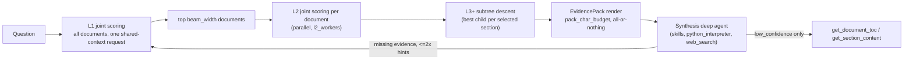

# Decision-Model Navigation for the Document Graph (DecisionRAG)

**Status**: design promoted from [docs/studies/decision_model_navigation.md](../studies/decision_model_navigation.md) after the 2026-11-02 OfficeQA Pro subset run (results & findings in the study §6)
**Owner**: genai-graph (`genai_graph/agent/decision_navigator.py`, `genai_graph/agent/decision_navigation.py`)
**Consumers**: officeqa (`config/agents.yaml` profile `decision`), genai-graph (`config/agents/docgraph.yaml` profile `docgraph_decision`)

---

## 1. Problem & adopted approach

Document Graph agents navigated with an LLM in the loop at every step (~6 tool calls and
~250k input tokens per OfficeQA question; failed runs degenerated into multi-million-token search
loops). The adopted design replaces the LLM navigation loop with a **decision model** (System-One,
zero generated tokens), per DecisionRAG (arXiv:2610.35868): at each level of the
`Folder ─CONTAINS→ Document ─HAS_SECTION→ MarkdownSection` hierarchy, every candidate branch is one
`Noul` (yes/no) question, and all candidates of a level are answered **jointly in one shared-context
request**; only the top-k branches expand. A small **synthesis deep agent** (the only LLM) reads the
resulting evidence pack and answers, with a bounded LLM-driven fallback.

Empirical note from the first run: navigation itself is precise and nearly free ($0.0007/question);
the cost/accuracy failures came from unbudgeted evidence packs being evicted and paged back via
`read_file`. The **pack budget** (§2.2) is therefore the load-bearing constraint of this design.

## 2. Architecture



### 2.1 `DecisionNavigator` (`genai_graph/agent/decision_navigator.py`)

- `DecisionNavigatorConfig` (Pydantic, extra=ignore): `decision_model` (tag or id for
  `get_decision_model`), `beam_width`, `top_r_sections`, `min_confidence`, `max_depth`,
  `candidate_cap`, `prefilter` (`off` | `hybrid`), `include_summaries`, `domain_context`,
  `answerable_gate`, `pack_char_budget`, `l2_workers`.
- Public surface: `rank_documents(query, folder_id)` (L1), `rank_sections(query, document_id)`
  (L2), `navigate(query, folder_id) -> EvidencePack` (beam search + descent + fetch).
- Shared-context rule (paper's +7.7 pts): all candidates of one parent are scored against the
  same `state` = question + refinement hints + `domain_context`. `batch_invoke` chunking by the
  provider's `max_questions` stays within one parent's list, so probabilities remain comparable.
- Domain routing knowledge (e.g. Treasury acronyms, revision-selection rules) is injected verbatim
  into `state` via `domain_context`/`domain_context_file` — navigation knowledge reaches the
  decision model; formulas/citations stay on the synthesis side.
- `answerable_gate` appends a corpus-level answerability `Noul` to the L1 request (MMLongBench
  unanswerable probes); below threshold, navigation short-circuits with `unanswerable: true`.
- Telemetry: every call's scores and usage accumulate into `NavigationTrace`
  (`dm_calls`, `dm_input_tokens`, `dm_output_tokens`, `dm_cost`, per-level scores/kept,
  `low_confidence`, `elapsed_ms`).

### 2.2 Evidence pack budget (the critical constraint)

`EvidencePack.render(pack_char_budget)` inlines sections **best-score-first, all-or-nothing**
(a silently truncated table is worse than a pointer). Over-budget sections render as:

```
### [<section_id>] <title> (document: …, score 0.xxx)
[text omitted: N chars over pack budget — fetch with get_section_content('<section_id>') if needed]
```

**Invariant**: `pack_char_budget + headers + trace footer < ObservationTruncationMiddleware.max_chars`.
An evicted pack is the worst outcome — the agent re-reads it through `read_file` in 30-line windows
(observed: 83 tool calls, 5.3M tokens for one question). OfficeQA profile: budget 10000, truncation 16000.

### 2.3 Tool factory & profiles

`create_decision_navigation_tools(db_path=None, *, profile, embeddings_id, max_image_queries,
**navigator_config)` (`genai_graph/agent/decision_navigation.py`) emits `navigate_folder` plus the
standard graph tools (fallback). All tuning arrives as tool-spec kwargs — every extra key of a
`factory:` entry in the profile's `tools:` list is passed to the factory; no bespoke profile section
and no change to `create_docgraph_agent` are needed. Bench variants (different decision models) are
sibling agent profiles differing only in factory kwargs.

The synthesis agent is `type: deep` (the only engine with the skill system), `enable_planning: false`.
Excess injected graph tools are stripped with `excluded_tools` (deepagents tool-exclusion middleware) —
OfficeQA excludes `get_folder_toc`, `search_sections`, `list_documents`; recovery is re-navigation with
`hints` (≤2) and `get_document_toc` / `get_section_content`; `query_image` stays for visual questions.

### 2.4 Benchmarks & telemetry

- `runs.jsonl` records a per-question `navigation` block (`dm_calls`, `dm_tokens`, `dm_cost`,
  `navigations`, `low_confidence`, `unanswerable`, `elapsed_ms`, per-level scores) extracted from the
  pack's `[[navigation-trace]]` JSON footer; `BenchSummary` aggregates `total_dm_calls/tokens/cost`.
- Gold-evidence hit rate is only computable where the dataset ships `evidence` (MMLongBench-Doc);
  OfficeQA Pro does not.
- Frozen comparison subset: `officeqa/bench/officeqa_dm_subset.json` (33 questions stratified by
  decade × document cardinality, incl. UID0005), generated by `officeqa/scratch_dm_subset.py`.

## 3. Ops & known issues

- **Decision-model registry must be present in the consuming project** (`config/providers/decision_models.yaml`)
  — tags resolve via `decision.models` config, but explicit `model@provider` ids and correct
  `max_questions`/real model names need the registry.
- Ladybug buffer pool: with several concurrent agents, size it explicitly (`LADYBUG_BUFFER_POOL_SIZE`)
  and keep bench concurrency moderate (≤6 observed exhaustion).
- A stale Prefect SQLite (old alembic revision, leftover `-wal`/`-shm`) blocks the managed server;
  reset `~/.prefect/prefect.db*` when the server refuses to start.
- deepagents `_aintercept_large_tool_result` assertion aborts runs on oversized tool results — pack
  budgeting removes the trigger; keep any other large tool outputs truncated.
- Older graphs key sections/images on `markdown_hash` instead of `content_hash`; query tools
  introspect the column (`_doc_key`). A rebuild is still advisable.

## 4. Validation

- Unit: `tests/unit_tests/agent/test_decision_navigator.py` (scripted decision model; beam selection,
  confidence gating, chunked levels, shared state, answerable gate, descent, pack budget, parallel L2,
  trace extraction/merge, factory kwargs) — offline, no network.
- Smoke: `DecisionNavigator(fake_model, db_path=…)` against the real officeqa corpus — navigation
  ~11 joint calls, pack under budget.
- Benchmark: `cli bench run -p decision_fast --skip fetch --skip build -q <subset ids>` then
  `cli bench grade -p decision_fast`; compare against the baseline restricted to the same ids.
